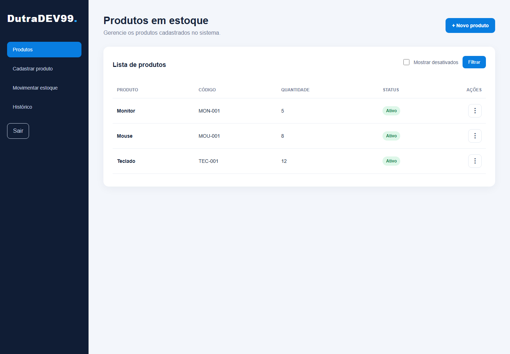

# Sistema de Gestão de Estoque

Projeto de portfólio de **DutraDEV99**, desenvolvido em Python/Django para demonstrar autenticação, gestão de produtos e controle de estoque com rastreabilidade.

O sistema permite cadastrar produtos, controlar entradas e saídas de estoque e consultar o histórico de movimentações, com autenticação de usuários.



Captura da interface com dados fictícios de demonstração.

## Tecnologias utilizadas

- Python
- Django 5.2
- SQLite (incluído no Python)
- HTML5
- CSS3
- JavaScript
- Git e GitHub

## Funcionalidades

### Autenticação
- Cadastro de usuários
- Login e logout
- Proteção de páginas para usuários autenticados
- Validação de senhas utilizando Django Auth

### Gestão de produtos
- Cadastro de produtos
- Listagem de produtos
- Edição de informações
- Código único por produto
- Ativação e desativação
- Exclusão de produtos sem histórico de movimentações

### Controle de estoque
- Registro de entradas
- Registro de saídas
- Atualização automática das quantidades
- Bloqueio de saídas com estoque insuficiente
- Bloqueio de movimentações em produtos desativados

### Histórico de movimentações
- Listagem de entradas e saídas
- Identificação do produto
- Quantidade movimentada
- Data e horário
- Identificação do usuário responsável

## Requisitos

Para executar o projeto, é necessário instalar:

- Python 3.10 ou superior, compatível com Django 5.2
- SQLite (incluído no Python)
- Git (opcional, para clonar o repositório)

## Instalação

### 1. Clonar o repositório

```bash
git clone https://github.com/DutraDEV99/case-estoque-keener.git Case-estoque
cd Case-estoque
```

Repositórios privados exigem autorização de acesso.

### 2. Criar o ambiente virtual

```bash
python -m venv .venv
```

### 3. Instalar as dependências

No Windows:

```powershell
.\.venv\Scripts\python.exe -m pip install -r requirements.txt
```

### 4. Banco SQLite

O projeto utiliza o arquivo `db.sqlite3` na raiz. Preserve esse arquivo para manter os dados existentes. O SQLite dispensa um servidor de banco de dados.

### 5. Configurar a chave do Django

Mantenha o valor existente de `DJANGO_SECRET_KEY`, se configurado. Em uma nova instalação, gere uma chave no PowerShell:

```powershell
$env:DJANGO_SECRET_KEY = & ".\.venv\Scripts\python.exe" -c "from django.core.management.utils import get_random_secret_key; print(get_random_secret_key())"
```

Essa variável permanece disponível apenas na sessão atual do terminal.

Para executar localmente por HTTP, ative também o modo de desenvolvimento:

```powershell
$env:DJANGO_DEBUG = "True"
```

No Linux/macOS, use `.venv/bin/python` nos comandos e `export DJANGO_DEBUG=True` e `export DJANGO_SECRET_KEY='sua-chave-gerada'` para as variáveis. O arquivo `.env.example` documenta as opções; o Django não carrega arquivos `.env` automaticamente.

### 6. Executar as migrações

```powershell
.\.venv\Scripts\python.exe manage.py migrate
```

### 7. Iniciar o servidor

```powershell
.\.venv\Scripts\python.exe manage.py runserver
```

Acesse:

http://127.0.0.1:8000/login/

## Como utilizar

1. Acesse a página de cadastro e crie uma conta.
2. Faça login.
3. Cadastre um produto com nome e código.
4. Registre uma entrada para adicionar unidades ao estoque.
5. Registre uma saída para retirar unidades.
6. Consulte o histórico das movimentações realizadas.
7. Use **Sair**, no menu lateral, para encerrar a sessão.

As listagens exibem 20 registros por página. O filtro de produtos desativados e a busca por produto ou usuário no histórico são aplicados no servidor, incluindo registros de outras páginas.

O estoque é compartilhado entre os usuários autenticados, e cada movimentação registra o responsável.

## Segurança e integridade

O sistema utiliza recursos nativos do Django, incluindo:

- Autenticação e armazenamento seguro de senhas
- Proteção CSRF em formulários
- Controle de acesso às páginas de estoque
- Validação dos dados enviados
- Transações atômicas nas movimentações
- Bloqueio de registros durante a atualização do estoque em PostgreSQL
- Preservação do histórico de movimentações
- Configuração de credenciais por variáveis de ambiente

O projeto está configurado para desenvolvimento local. Para utilização em produção, são necessárias configurações adicionais de hospedagem, HTTPS e segurança.

## Validação e testes

Com `DJANGO_SECRET_KEY` configurada:

```powershell
.\.venv\Scripts\python.exe manage.py check
.\.venv\Scripts\python.exe manage.py makemigrations --check --dry-run
.\.venv\Scripts\python.exe manage.py test
```

Os testes usam um banco separado e cobrem autenticação, CSRF no logout, produtos, entradas e saídas, saldo insuficiente, rollback de transação, proteção do histórico, paginação e filtros. O banco local não é usado como banco de testes. O GitHub Actions executa essas verificações automaticamente.

## Administração

Crie um administrador com `python manage.py createsuperuser` (usando o Python do ambiente virtual) e acesse `/admin/`. Produtos podem ser pesquisados e gerenciados. O saldo não é editável e o histórico de movimentações é somente para consulta; registre entradas e saídas pela interface de estoque.

## Decisões técnicas e limites

- **SQLite** é o padrão local, sem servidor adicional. O arquivo `db.sqlite3` é ignorado pelo Git.
- **PostgreSQL** é suportado por `DATABASE_URL` em produção. MySQL não é necessário nem faz parte da configuração atual.
- As movimentações usam `transaction.atomic()` para gravar saldo e histórico juntos. PostgreSQL oferece o bloqueio por linha de `select_for_update()`; SQLite não oferece essa mesma garantia e é indicado aqui para desenvolvimento e demonstração, sem alta concorrência.
- O estoque é compartilhado: qualquer usuário cadastrado pode gerenciar produtos e registrar movimentações. Não há separação por empresa nem perfis de autorização de negócio.
- `base.html` concentra a estrutura HTML; os estilos compartilhados e específicos ficam em `estoque/static/estoque/`.
- Senhas são tratadas pelo Django Auth; chaves e URLs de banco são fornecidas por variáveis de ambiente.

## Produção

Use `DJANGO_DEBUG=False`, uma `DJANGO_SECRET_KEY` própria, `DJANGO_ALLOWED_HOSTS` e `DJANGO_CSRF_TRUSTED_ORIGINS` correspondentes ao domínio. Configure `DATABASE_URL` para PostgreSQL; as conexões usam SSL quando o modo de desenvolvimento está desativado. O padrão exige HTTPS e cookies seguros, com HSTS de uma hora. Ajuste `DJANGO_HSTS_SECONDS` conforme a política da hospedagem; em desenvolvimento o padrão é zero.

Execute `python manage.py migrate`, `python manage.py collectstatic --noinput` e `python manage.py check --deploy` no ambiente de hospedagem. WhiteNoise serve os estáticos coletados. Em um servidor Linux, o processo pode ser iniciado com `gunicorn config.wsgi:application`. Configure o proxy HTTPS de confiança e backups do banco; não exponha diretamente o servidor de desenvolvimento.

O diagnóstico de produção pode emitir `security.W005` e `security.W021`: a aplicação deixa HSTS para subdomínios e preload desativados por padrão. Ative `DJANGO_HSTS_INCLUDE_SUBDOMAINS=True` e `DJANGO_HSTS_PRELOAD=True` somente após verificar que todos os subdomínios suportam HTTPS e decidir aderir à política de preload. Esses avisos não são erros de execução.

## Estrutura

```text
config/                    Configuração e rotas
estoque/models.py          Produtos e movimentações
estoque/views.py           Formulários e fluxos do estoque
estoque/admin.py           Administração e consulta do histórico
estoque/tests.py           Testes automatizados
estoque/templates/         Template base e páginas
estoque/static/estoque/    Estilos compartilhados e por página
```

## Autor

**Wendel Dutra**

GitHub: https://github.com/DutraDEV99
